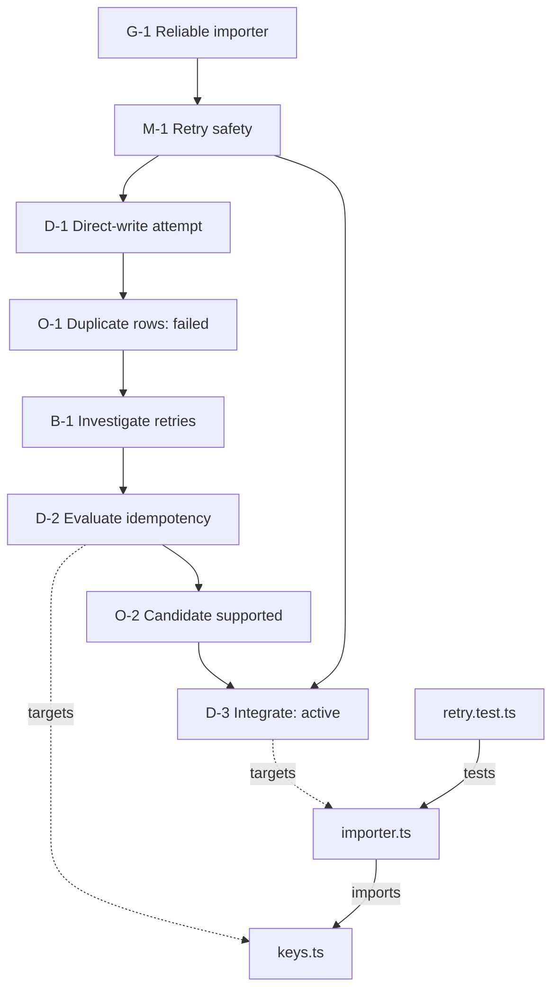

# Illustrative branch and code map

**Entirely synthetic example. No repository, test result, branch, or acceptance below is claimed as real.** The same data appears in `atlas-example.json` for schema verification and a potential viewer fixture.

Goal: a reliable importer. A direct-write attempt fails under retries. Investigation branches from that failed outcome, finds an idempotency design, and rejoins at a new integration directive. The failed attempt stays visible.

The graph shows two layers: the goal-to-outcome journey and the code's connections. In Both view, explicit bridge links connect directives to files. Tests in this diagram show intended relationships; their presence does not mean they passed.

| Browse address | Stable alias | Meaning |
|---|---|---|
| 100.010 | M-1 | Milestone |
| 100.010.010 | D-1 | Original attempt |
| 100.010.020 | B-1 | Retry investigation |
| 100.010.020.010 | D-2 | Bounded branch work |
| 100.010.030 | D-3 | Continuation/rejoin |

Reclassifying D-2 does not change its identity or erase its origin. A real viewer opens at D-3, collapses earlier branches, and lets a user search “duplicate rows” to recover the reason and evidence. Code-only search can focus on importer.ts; Both view can explain the directive behind its idempotency work.
